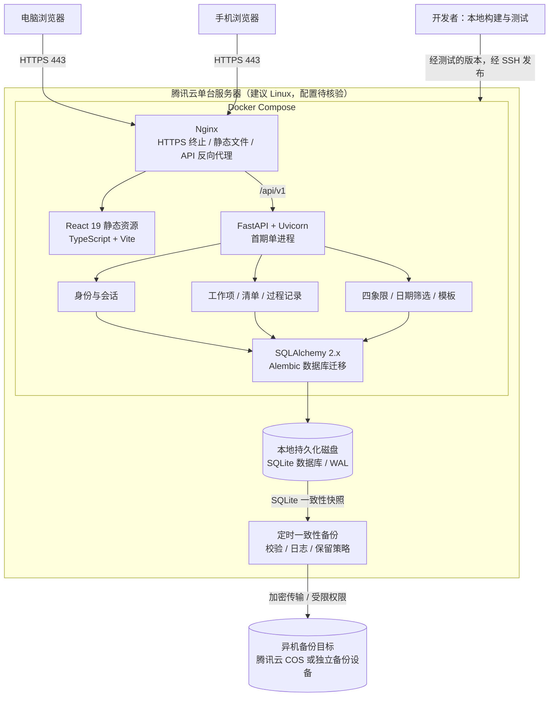

# EfficiencyDay 首期技术架构与上线时间表

- 版本：v0.1
- 编制日期：2026-10-19
- 状态：架构与排期建议，具体业务规则及服务器条件在第一周确认
- 需求依据：[初始需求文档](./requirement/EfficiencyDay-requirements-v0.1.md)
- 已确认约束：单人开发，每周约 20–25 小时；一个月内上线测试；Python / FastAPI + React 19 + SQLite；已有腾讯云服务器
- 已确认首期范围：个人在线 MVP，优先完成任务管理闭环

## 1. 结论与取舍

推荐采用“单机部署、前后端分离开发、同域发布、后端模块化单体”的架构。

React 构建后的静态文件与 FastAPI 通过同一个 HTTPS 入口访问；数据库保存在服务器持久化磁盘。不同设备登录同一个账号后访问同一份云端数据，不建设离线同步引擎。

| 方案 | 优点 | 成本与边界 | 结论 |
| --- | --- | --- | --- |
| 单机 + SQLite | 部署简单、组件少，适合个人低写入量试用 | 单写者、单机故障点，需要可靠备份 | 首期推荐 |
| 单机 + PostgreSQL | 写并发与后续扩展能力更强 | 增加数据库运维、资源及调试成本 | 数据压力明确后再评估 |
| 托管数据库 + 多实例服务 | 更容易扩展与做高可用 | 费用、部署和运维复杂度超出本月重点 | 暂不采用 |

不引入微服务、Redis、Celery、WebSocket 或 Kubernetes。首期不做高可用；单机维护期间允许短暂不可用。SQLite 不是无限扩展方案，也不将它当作多台服务器共享的数据库。

## 2. 首期交付边界

### 2.1 本月必须完成

- 一个预置个人账号的登录、退出及登录态保护；不开放注册，不建设找回密码邮件流程。
- 工作项创建、编辑、状态流转与历史查看。
- 列表和四象限视图，包含待分类任务入口。
- 详情包含背景与目标、执行清单、过程记录、结果与复盘；文本使用普通文本，不做复杂富文本。
- 录入、开始、目标完成、实际完成四类日期的筛选与每日归纳。
- 未关闭与已关闭任务的分组和确定性排序。
- 少量预置模板，创建时填充默认值；不建设模板管理后台。
- 桌面与手机浏览器的基础响应式布局。
- 云端保存；设备刷新或页面重新获得焦点时重新取数；冲突检测与失败提示。
- HTTPS 部署、日志、健康检查、备份及恢复验证。

### 2.2 本月明确不做

年度计划、图片识别、语音识别、HTML 导入导出、离线编辑、实时推送、附件、多用户开放注册、团队权限和复杂报表。

“多设备可访问”不等于完整同步产品：不保证其他已打开设备立即刷新，不提供断网编辑队列，保存失败不得显示为已保存。

## 3. 技术架构图

图中的后端模块属于同一个 FastAPI 应用，不是独立服务。React 在浏览器执行，图中的静态资源由 Nginx 提供；数据库只允许后端访问。

### 3.1 技术组件

| 层次 | 建议技术 | 职责与约束 |
| --- | --- | --- |
| 前端 | React 19、TypeScript、Vite | 单页应用与构建；具体依赖版本在首周验证兼容后锁定 |
| 页面与组件 | React Router、Ant Design | 路由及现成表单、列表、日期组件；验证 React 19 兼容配置 |
| 服务端数据 | TanStack Query | 查询缓存、保存后失效刷新；不将浏览器缓存作为数据源 |
| HTTP API | FastAPI、Pydantic | 输入输出校验、OpenAPI 契约、统一错误响应 |
| 应用服务 | Python 模块化单体 | 状态与日期规则、用户隔离、版本冲突处理 |
| 数据访问 | SQLAlchemy 2.x、Alembic | 显式事务、数据模型和可追踪迁移；首期用同步 Session 与同步数据库路由 |
| 数据库 | SQLite | 本地文件、WAL、短事务、单 API 实例 |
| 部署 | Nginx、Docker Compose、Uvicorn | 同域发布、持久化挂载、重启策略与健康检查 |
| 测试 | pytest、Vitest、Playwright | 后端规则与 API、前端关键逻辑、主流程端到端测试 |

先不加 Redux 等全局状态框架；界面局部状态使用 React 自带能力，服务端数据交由查询库维护。

### 3.2 后端边界

- `api`：HTTP 路由、请求响应模型、认证依赖，不承载重复业务规则。
- `services`：任务状态、日期归纳、模板实例化及版本校验。
- `db`：SQLAlchemy 模型、会话、事务与迁移。
- `core`：配置、密码与会话安全、日志、错误处理。

避免为每个模型建设空壳仓储层，或提前抽象跨数据库兼容框架。首期通过清晰的服务与数据访问边界，为未来迁移保留空间，但迁移 PostgreSQL 仍需重新测试。

## 4. 数据设计与一致性

### 4.1 建议数据表

| 表 | 主要内容 |
| --- | --- |
| users | 个人用户、密码哈希、显示时区 |
| sessions | 会话令牌哈希、用户、到期时间；退出时撤销 |
| work_items | 用户、标题、状态、紧急/重要、颜色、关键日期、背景目标、结果复盘、版本号 |
| checklist_items | 所属任务、条目内容、完成标记、顺序 |
| work_item_notes | 所属任务、过程记录、记录时间 |
| task_templates | 预置模板及默认字段，创建任务时复制，不回写旧任务 |

每条任务归属一个用户，所有任务查询和更新均校验归属。即使首期只有一个账号，也不允许仅凭任务 ID 直接访问。

### 4.2 日期和状态建议

- 系统时间戳使用 UTC；个人显示时区建议设为 Asia/Shanghai，每日归纳按该时区计算。
- 目标完成日期按日存储，不人为补成 UTC 零点；开始、完成时间与日历日期在 API 中明确区分。
- 建议状态为待开始、进行中、已完成、已取消；已完成和已取消视为关闭，但只有已完成计入完成统计。
- 状态流转、重新打开后的完成时间及排序细节，在第一周依据需求文档定稿并加入后端测试，不由前端各自推断。

### 4.3 多设备修改

1. 前端读取任务时获得 `version`。
2. 保存时携带读取到的版本；后端以用户、任务 ID 与版本为条件进行原子更新。
3. 更新成功后递增版本；同时修改清单等子记录时也必须在同一事务中校验并更新父任务版本。
4. 版本不匹配返回 HTTP 409；前端保留草稿，提示加载最新内容后手动合并或重新提交，不静默覆盖。
5. 断网或请求超时时显示“保存未确认”，保留输入并允许重新核对；列表以服务端成功响应为准。

首期明确点击保存，不做自动保存和离线队列，以降低一致性复杂度。

## 5. SQLite 使用边界

- 数据库位于服务器本地持久化目录，挂载到 API 容器；不能写在随容器销毁的可写层，也不能置于 Nginx 静态目录。
- 启用 WAL、每个连接的外键约束以及有限的忙等待超时；持久性建议采用 `synchronous=FULL`。
- 首期一个 API 实例、一个 Uvicorn worker；这不消除线程间竞争，仍需短事务与数据库原子条件更新。
- 不在事务中进行远程服务调用，不开启不受控的批量写入。锁等待超时返回明确的可重试错误，不能吞掉异常。
- 按实际查询为用户、状态和日期建立必要索引，列表采用分页；四象限使用明确的分页或加载策略，不无限读取。
- 不通过网络文件系统、多节点共享文件或简单增加实例来扩展 SQLite。
- 若目标负载下出现持续写锁等待，或需要多个 API 实例及高可用，再评估迁移 PostgreSQL；以压测和日志为依据，不承诺固定用户数上限。

## 6. 部署、安全与运维

### 6.1 上线前置条件

第一周确认服务器地区、操作系统、CPU、内存、可用磁盘、SSH 访问、域名及证书条件。2 核 2 GB 可作为低负载试用的评估起点，不作为未经验证的容量保证；前端尽量在本地构建。

如果服务器位于中国大陆，需提前核实域名备案及对应接入要求，办理时间不包含在开发工时中。不得通过临时域名或 IP 绕过相关要求。若公网条件未就绪，可先进行符合要求的受限内测，公网开放日期另定。

### 6.2 入口与认证

- 仅 Nginx 暴露 Web 端口，80 用于跳转 HTTPS 或证书验证；API 端口不映射公网，SQLite 无独立网络端口。
- SSH 使用密钥，安全组尽可能限制管理来源；数据库、备份和环境配置均不允许公开读取。
- 采用服务端可撤销会话，浏览器仅保存随机会话 Cookie，设置 HttpOnly、Secure、SameSite。
- 同域部署；所有写请求验证 CSRF 令牌并检查来源。密码使用成熟的 Argon2id 实现，不存明文。
- 登录失败使用统一提示，设置限速；会话设定有效期，退出后失效。
- 密钥及密码由受限环境配置提供，不写入仓库、镜像或前端构建变量。

### 6.3 发布与维护

- 本地测试通过后构建带版本标签的镜像，上传或导入服务器，经 SSH 执行发布；首期不依赖复杂流水线。
- 发布步骤：备份 → 暂停应用写入 → 单次执行数据库迁移 → 启动目标版本 → 健康检查 → 登录与任务读写冒烟。
- 记录版本、迁移版本和部署时间。保留上一版镜像；应用回滚前确认数据库兼容性，不自动反向迁移破坏数据。
- 若必须恢复旧备份，先保留故障现场，并明确恢复点之后的数据损失；迁移演练使用数据库副本。
- 容器设置重启策略；日志包含请求 ID、错误信息与耗时，不记录密码、会话令牌或任务正文，设置日志轮转。

### 6.4 备份与监测

- 建议每日生成一致性备份，并在每次迁移前额外备份；保留最近 7 个每日备份，异机副本至少同等保留。
- 使用 SQLite 在线备份 API 或其他经过验证的一致性备份方式；不能仅复制正在写入的主数据库文件而忽略 WAL。
- 备份完成后校验可打开及数据库完整性，再上传至私有 COS 或其他独立设备；失败必须记录并通知维护者。
- 上线前恢复到独立目录并启动隔离测试实例，检查任务、清单、过程记录与状态日期，不能只验证“有备份文件”。
- `/health/live` 检查进程，`/health/ready` 检查数据库可访问及迁移版本；检查磁盘用量、HTTP 5xx、锁超时和备份结果。
- 备份恢复目标建议为最多损失 24 小时数据、4 小时内恢复；这是待演练验证的目标，不是已具备的保证。单机自身的备份不能防止整机或磁盘丢失。

## 7. 一个月实现时间表

### 7.1 日期与工时

以 2026-10-19 开始，目标 2026-11-15 发布内测版，2026-11-16 至 11-18 保留缓冲，最迟争取在 2026-11-18 完成上线验证。

四周主计划每周 22 小时，共 88 小时；另预留 6 小时机动，总投入约 94 小时。估算包含学习、联调与缺陷修复，前提是具备 Python / React 基础，不包含等待备案、采购或第三方审批的自然时间。

| 阶段 | 日期 | 工作内容与工时 | 里程碑 / 验收出口 |
| --- | --- | --- | --- |
| 第 1 周：打通纵向链路 | 10-19～10-25 | 规则及环境确认 4h；项目骨架与依赖锁定 4h；数据模型与迁移 4h；登录及任务创建/读取最小链路 6h；服务器首次部署 4h | 能经受保护的入口登录、创建任务并刷新读取；重启容器数据仍在；HTTPS/公网前置条件明确 |
| 第 2 周：完成核心任务管理 | 10-26～11-01 | 编辑及状态规则 5h；四象限与待分类入口 4h；详情区域、清单、过程记录 6h；基础响应式与冲突提示 3h；针对性自动化测试和联调 4h | 创建、编辑、执行、完成和查看历史闭环可用；两设备旧版本保存返回冲突且不丢草稿 |
| 第 3 周：补齐日常使用 | 11-02～11-08 | 四类日期归纳与排序 5h；预置模板 3h；跨设备刷新及错误状态 3h；手机体验修整 3h；查询及日期/状态自动化测试 4h；自用试运行与修复 4h | 用真实日常任务连续试用，日期口径、模板、排序与错误提示符合定稿规则 |
| 第 4 周：上线加固 | 11-09～11-15 | 权限与会话负向测试 4h；主流程端到端及负载测试 5h；备份、恢复与回滚演练 5h；缺陷修复 5h；发布及运维说明 3h | 达到第 8 节上线门槛，发布带版本标签的内测版 |
| 缓冲期 | 11-16～11-18 | 机动 6h，只处理阻断上线的问题，不加新功能 | 完成上线后的设备验证、备份检查和缺陷确认 |

### 7.2 执行节奏与依赖

- 每周可按 4 个工作日晚间各 2 小时、周末合计 14 小时安排，避免每天切换多个模块。
- 第一周必须实际部署一次，不把服务器问题推迟到最后一周。
- 顺序：规则与数据模型 → 登录及最小任务链路 → 核心页面 → 日归纳与模板 → 加固和上线。
- 后端规则测试随功能编写；第四周用于补齐回归与演练，而不是首次开始测试。
- 11-08 功能冻结。11-09 起新增需求进入后续版本，不挤占安全、数据和恢复验证时间。

### 7.3 延期处理

- 第 1 周若域名、HTTPS 或服务器环境阻塞，先解决访问链路；外部审批未完成时调整为受限内测，不声称已经公网开放。
- 第 2 周若核心闭环未完成，优先简化视觉样式、减少预置模板数量，并压缩手机端非关键交互。
- 若仍超时，与用户明确重新确认范围或延期；不静默删掉已承诺能力。
- 不以关闭鉴权、取消版本冲突检测、跳过迁移/恢复演练或删掉备份换取准时上线。

## 8. 上线验收门槛

以下为建议验收目标，不代表已经测试通过。第一周按服务器条件确认负载指标，但不能在上线时以未说明的低负载替代。

| 类别 | 验收要求 |
| --- | --- |
| 功能 | 登录 → 模板或手动建任务 → 列表/四象限 → 详情与清单 → 完成 → 每日回顾，全链路通过 |
| 日期 | 覆盖 UTC 与个人时区跨日边界、无目标日期、相同日期排序及重新打开任务 |
| 数据隔离 | 未登录访问被拒绝；使用测试夹具构造另一用户，不能读写其任务及子记录 |
| 会话 | 登录失败限速、退出失效、Cookie 安全属性与写请求 CSRF 校验通过 |
| 跨设备 | 手机与电脑刷新后数据一致；旧版本更新返回 409；网络失败不伪装保存成功 |
| 持久化 | 容器重建及服务器重启后数据仍在，迁移仅按受控流程运行 |
| 恢复 | 将异机备份下载并恢复到隔离实例，能登录和读取代表性任务，记录耗时和恢复点 |
| 性能 | 建议以 1 万条任务、每页 50 条、5 个并发客户端、读写比 9:1 持续 10 分钟；服务器侧列表/详情/更新请求 p95 ≤ 500ms，非预期 5xx 为 0，成功写入无丢失 |
| 性能边界 | 冲突测试与性能测试分开；性能测试使用互不冲突的修改，不把预期 409 算成服务故障；记录服务器配置、请求数及数据库锁等待 |
| 用户体验 | Chrome 桌面与至少一台实际手机浏览器完成主流程，无阻断操作的溢出或遮挡 |
| 运维 | HTTPS 有效、健康检查可用、日志轮转正常、备份失败可发现、上一版本回滚路径可执行 |

## 9. 主要风险与后续演进

| 风险 | 处理策略 |
| --- | --- |
| 单人 80–100 小时内范围膨胀 | 固定 MVP，优先完整闭环，11-08 后冻结功能 |
| 对 React 19 生态兼容性估计不足 | 首周验证组件库与测试工具，不盲目升级全部依赖 |
| SQLite 写锁或迁移问题 | 短事务、明确超时、版本条件更新、迁移演练与负载测试 |
| 单机失效 | 持久化目录、异机一致性备份与恢复演练；承认没有高可用 |
| 登录和部署低估 | 第一周就加入认证并部署；不等待功能全部完成 |
| 学习成本超出估算 | 每周按验收出口复盘，超出预算及时重排，不压缩数据可靠性 |

内测稳定后，再依次评估年度计划、用户可编辑模板及智能录入。图片/语音需另行设计外部服务授权、数据留存、超时重试和候选确认。是否迁移 PostgreSQL 由部署扩展与写入负载决定，不因引入智能录入自动迁移。

## 10. 第一周需落实的输入

1. 腾讯云服务器地区、系统版本、CPU/内存/磁盘及域名与 HTTPS 条件。
2. 状态流转、关闭与重新打开、日期精度、排序、详情编辑范围。
3. 预置模板清单、个人时区、初始化账号及密码维护方式。
4. 异机备份位置、凭据管理与失败通知方式。

本文只规划架构与实现节奏，不表示已开始搭建、配置服务器或验证任何上线指标。
